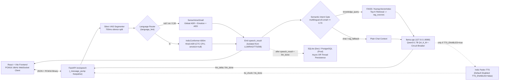

# VoiceSense AI

VoiceSense AI is a modular, local-first, multilingual, emotion-aware voice assistant built with FastAPI, React/TypeScript, Silero VAD, SenseVoiceSmall, AI4Bharat IndicConformer-600m, intent-gated `multilingual-e5-small` RAG, and local `Qwen3-1.7B` GGUF inference via `llama.cpp`.

> [!NOTE]
> All documentation in this repository distinguishes between **`real-verified`** capabilities measured against actual models/weights, automated CI-lite test coverage, and **`unverified` / `NOT YET MEASURED`** components. See [`docs/architecture/status.md`](docs/architecture/status.md) for the live verification ledger.

---

## 1. Project Overview

VoiceSense AI processes live microphone PCM16 audio over WebSocket (`/ws/speech`) without persisting raw audio to disk:
- **Perception First:** Speech-to-Text (ASR), discrete emotion tags, and audio events (`speech_result`) are emitted before any LLM generation, RAG retrieval, or database write begins. If downstream services fail, speech perception continues working.
- **Explicit Language Routing:** Global speech (`en`, `zh`, `yue`, `ja`, `ko`, or `null` Auto) routes to `SenseVoiceSmall`; Hindi (`language_hint="hi"`) routes explicitly to `IndicConformer-600m` (`emotion: null`).
- **Hard-Gated RAG:** Knowledge retrieval runs only when semantic intent similarity (`intfloat/multilingual-e5-small`) crosses threshold (`0.70` default); plain conversation bypasses RAG.
- **Local-First Privacy:** Local services bind to `127.0.0.1`, transcripts only persist when `STORE_TRANSCRIPTS=true` on authenticated sessions, and `DELETE /api/history` purges user history.

---

## 2. Architecture Diagram



Full module boundaries, failure-isolation guarantees, lazy loading, and memory numbers are documented in [`docs/architecture/architecture.md`](docs/architecture/architecture.md).

---

## 3. Features

### Verified Against Real Models (`real-verified`)
- **Non-Blocking WebSocket Voice Streaming & Cold-Load Keepalive:** Silero VAD 512-sample segmentation (`700 ms` silence split), multi-segment `speech_result` dispatch (`debug.segment_index`), lazy model loading (`loading_model` / `model_ready` status banners), and `_message_pump` ping handling (`225.9 ms` max event-loop stall over a `49 s` cold load; `docs/deployment/runs/run_phase10_e2e_real.txt`).
- **Global ASR + Discrete Emotion/Event Tags (`SenseVoiceSmall`):** Tested on synthetic English speech (`english_speech_16k.wav`), emitting clean text, language `en`, normalized emotion (`neutral`), `confidence: null`, and acoustic events.
- **Hindi ASR Routing (`IndicConformer-600m`, Pinned Revision):** Explicit `language_hint="hi"` routes to CPU CTC inference (`"आज मौसम बहुत अच्छा है"` on real `5.28 s` Hindi clip, median `1,198.1 ms`, RTF `0.23`), emitting `emotion: null, confidence: null`.
- **Intent-Gated RAG:** `intfloat/multilingual-e5-small` (`384`-dim embeddings) + FAISS `IndexFlatIP` (with automatic `NumpyVectorIndex` fallback when `faiss` is blocked on Windows SAC), reaching `47/50` (`94.0%`) on the agent-authored hard gate eval (`docs/deployment/runs/hard_gate_eval_8i.txt`).
- **Local LLM Streaming & Circuit Breaker (`Qwen3-1.7B` Q4_K_M):** `127.0.0.1:8080` OpenAI-compatible SSE client with `<think>` filtering, repetition safeguards (`repeat_penalty=1.1`, `frequency_penalty=0.2`, `max_tokens=120`), and failure isolation (`speech_result` arrives even when LLM is down).

### Implemented & Automated / Partial / Unverified
- **Authentication & History (`integration` / `live turn` verified):** `hashlib.scrypt` password hashing, HS256 JWT tokens, per-IP/per-session rate limits, user-isolated SQLite sessions, and `DELETE /api/history` purge. PostgreSQL runtime execution is **`unverified`**.
- **React Dashboard UI (`automated unit/build` & Phase 9b Playwright verified):** Language selector (`Auto`, `English`, `Hindi`), status banner, multi-segment utterance list, RAG source badges, voice-replies-disabled notice, in-memory token auth modal (no `localStorage`), and history panel. Note: backend `/api/health` does not emit `auth_required`; the frontend reads build-time `VITE_AUTH_REQUIRED`.
- **Expressive TTS (`Indic Parler-TTS` — Disabled by Default):** `TTS_ENABLED=false` by default; RTX 2050 benchmarking showed RTF `2.65–13.15` (slower than real time) and Windows virtual commit exhaustion (`docs/deployment/tts-benchmark-rtx2050.md`).
- **Docker Compose Stacks (`config -q` syntax verified; runtime `unverified`):** Container builds and multi-service Compose runs were not executed (Docker daemon stopped).

---

## 4. Tech Stack

| Layer | Technology |
|---|---|
| **Frontend** | React 18, TypeScript, Vite, Tailwind CSS, Vitest, ESLint |
| **Backend API** | Python (`3.11+`; verified on `3.13.14`), FastAPI, Uvicorn (`--workers 1`), Pydantic Settings |
| **VAD & ASR / Emotion** | `snakers4/silero-vad`, `FunASR` (`iic/SenseVoiceSmall`), `NeMo` (`ai4bharat/indic-conformer-600m-multilingual`) |
| **RAG & Embeddings** | `sentence-transformers` (`intfloat/multilingual-e5-small`), FAISS `IndexFlatIP` + `NumpyVectorIndex` fallback |
| **Local LLM** | `Qwen/Qwen3-1.7B` (`Q4_K_M` GGUF) served by local `llama.cpp` (`llama-server`) |
| **Persistence** | SQLAlchemy 2.x (sync in threadpool), Alembic, SQLite (dev default), PostgreSQL schema (prod target) |
| **CI & Verification** | GitHub Actions (`ubuntu-latest`), `pytest` (`--import-mode=importlib`), `scripts/ci/check_import_isolation.py` |

---

## 5. Installation (Windows & Linux/WSL)

Two split requirement sets avoid forcing CI or backend-only contributors to install multi-gigabyte ML dependencies:
- **CI-Lite (`.venv-ci`):** `requirements-ci.txt` (FastAPI, SQLAlchemy, Alembic, pytest, zero Torch/FunASR/NeMo).
- **Full ML (`.venv`):** `requirements/runtime.txt`, `requirements/ml.txt`, `requirements/dev.txt`.

### Windows (PowerShell — Verified Environment)
```powershell
# 1. Create CI-lite environment for API / DB / WS tests
python -m venv .venv-ci
.\.venv-ci\Scripts\python.exe -m pip install --upgrade pip
.\.venv-ci\Scripts\python.exe -m pip install -r requirements-ci.txt

# 2. (Optional) Full ML environment for real speech/RAG/training
python -m venv .venv
.\.venv\Scripts\python.exe -m pip install -r requirements/runtime.txt -r requirements/ml.txt -r requirements/dev.txt

# 3. Frontend dependencies
cd frontend
npm ci
cd ..
```

### Linux / WSL (`unverified` on local Linux workstation; mirrors GitHub Actions CI)
```bash
# Optional system audio libraries on Debian/Ubuntu (unverified locally)
# sudo apt-get update && sudo apt-get install -y ffmpeg libsndfile1

python3 -m venv .venv-ci
.venv-ci/bin/python -m pip install --upgrade pip
.venv-ci/bin/python -m pip install -r requirements-ci.txt

# Full ML dependencies (unverified locally on Linux)
# .venv/bin/python -m pip install -r requirements/runtime.txt -r requirements/ml.txt -r requirements/dev.txt
```

See [`docs/SETUP.md`](docs/SETUP.md) for Windows Smart App Control (`SAC`) notes and environment configuration.

---

## 6. Local Development

```powershell
# Copy env template (first time only)
Copy-Item .env.example .env

# Run Alembic DB migrations & inspect current revision
.\.venv-ci\Scripts\alembic.exe current

# Verify package boundary isolation (`ai/` and `speech_service.py` stay isolated from LLM/RAG/TTS)
.\.venv-ci\Scripts\python.exe scripts/ci/check_import_isolation.py

# Run fast CI-lite unit + integration test suite (no ML weights required)
.\.venv-ci\Scripts\python.exe -m pytest -m "not model and not slow and not gpu and not postgres"

# Frontend tests, typecheck, lint, and production bundle check
cd frontend
npm test -- --run
npx tsc --noEmit
npm run lint
npm run build
cd ..
```

Start the local servers in separate terminals *(uvicorn `/api/health` verified in Phase 12; full long-running multi-terminal interactive session `unverified` in Phase 12 batch check)*:

```powershell
# Terminal 1: FastAPI backend (single worker + keepalive ping flags for lazy model loading)
.\.venv\Scripts\python.exe -m uvicorn backend.app.main:app --host 127.0.0.1 --port 8000 --workers 1 --ws-ping-interval 20 --ws-ping-timeout 20

# Terminal 2: React Vite dev server (http://127.0.0.1:5173)
cd frontend && npm run dev

# Terminal 3 (Optional): Local llama.cpp Qwen3-1.7B server on 127.0.0.1:8080 (unverified in Phase 12 batch; stopped OK)
# llama-server -m C:\path\to\Qwen3-1.7B-Q4_K_M.gguf --host 127.0.0.1 --port 8080 -ngl 24
```

Walk through the live workflow using [`docs/DEMO.md`](docs/DEMO.md).

---

## 7. Model Setup

Model weights are **never committed to Git** and **never baked into Docker images**.

| Model | Purpose | Identifier / Source | Pinned Revision & Location | Gated / Auth |
|---|---|---|---|---|
| **Silero VAD** | 32 ms speech boundary detection | `snakers4/silero-vad` | Default bundled / `SILERO_VAD_MODEL_PATH` (`models/silero_vad.onnx`) | No |
| **SenseVoiceSmall** | Default ASR (`zh/yue/en/ja/ko`) + emotion + AED | `iic/SenseVoiceSmall` (ModelScope / HF cache) | `SENSEVOICE_MODEL_DIR` -> `MODELSCOPE_CACHE` / `HF_HOME` | No |
| **IndicConformer-600m** | Hindi ASR (`language_hint="hi"`, CTC CPU default) | `ai4bharat/indic-conformer-600m-multilingual` | Pinned `INDICCONFORMER_REVISION`: **`2a77d305038dfc502fd9464e7d028b90381976cb`** | **Yes (`HF_TOKEN`)** |
| **Qwen3-1.7B GGUF** | Local conversational LLM | `unsloth/Qwen3-1.7B-GGUF` (`Q4_K_M`) | Local GGUF loaded by `llama-server` on `127.0.0.1:8080` | No |
| **multilingual-e5-small** | Intent router + RAG chunk embeddings (`384`-dim) | `intfloat/multilingual-e5-small` | Cached under `HF_HOME` | No |
| **Indic Parler-TTS** | Emotion-styled TTS (disabled by default) | `ai4bharat/indic-parler-tts` | `TTS_ENABLED=false` (`.venv-tts` isolated worker) | Requires HF access |

### Downloading Gated Models (`IndicConformer-600m`)
1. Visit [`ai4bharat/indic-conformer-600m-multilingual`](https://huggingface.co/ai4bharat/indic-conformer-600m-multilingual) and accept the repository terms while signed in to Hugging Face.
2. Export your read token at runtime (never store it in committed `.env` or Docker images):
   ```powershell
   $env:HF_TOKEN = "hf_..."
   ```
3. Keep `INDICCONFORMER_REVISION=2a77d305038dfc502fd9464e7d028b90381976cb` in `.env` so NeMo downloads match the pinned revision verified on CPU (`ctc` decoder).

Quick SenseVoice CLI silence sanity check:
```powershell
.\.venv\Scripts\python.exe -m ai.inference.sensevoice --test-silence
```

---

## 8. Environment Variables

Defaults verified directly against `backend.app.core.config.Settings` and `.env.example`:

| Variable | Default | Service / Purpose |
|---|---|---|
| `APP_ENV` / `ENVIRONMENT` | `development` | Enables strict production checks (`JWT_SECRET` length) when `production` |
| `HOST` / `PORT` / `DEBUG` | `127.0.0.1` / `8000` / `False` | Backend listen address (`127.0.0.1` local-only default) |
| `CORS_ORIGINS` | `['http://localhost:5173', 'http://127.0.0.1:5173', 'http://localhost:3000', 'http://127.0.0.1:3000']` | Allowed browser origins |
| `LOG_LEVEL` / `LOG_TRANSCRIPTS` | `INFO` / `False` | Never log spoken text in production |
| `AUTH_REQUIRED` | `False` | Require JWT `auth_token` in `/ws/speech` `start` frame (`REQUIRE_AUTH` also defined on `Settings`, unused) |
| `JWT_SECRET` / `SESSION_TIMEOUT_MINUTES` | Dev fallback secret / `60` | HS256 JWT signing (>= 32 chars required in `production`) |
| `DATABASE_URL` / `STORE_TRANSCRIPTS` | `sqlite:///./database/dev.db` / `True` | SQLite dev DB or PostgreSQL URL; controls DB transcript storage |
| `RATE_LIMIT_UTTERANCES_PER_MINUTE` | `20` | Sliding window limit per WebSocket session |
| `RATE_LIMIT_AUTH_PER_MINUTE` | `10` | Per-IP rate limit on `/api/auth/register` and `/api/auth/login` |
| `MAX_UTTERANCE_DURATION_SECONDS` / `WS_MAX_BUFFER_BYTES` | `30.0` / `5242880` | Per-turn duration cap (30 s) and WS buffer cap (5 MB) |
| `MAX_UPLOAD_SIZE_BYTES` / `MAX_RAG_UPLOAD_SIZE_BYTES` | `10485760` | 10 MB multipart upload cap |
| `INFERENCE_CONCURRENCY_LIMIT` | `2` | Asyncio semaphore bounding worker-thread ASR inference |
| `VAD_THRESHOLD` / `SILERO_VAD_MODEL_PATH` | `0.5` / `models/silero_vad.onnx` | `SILERO_VAD_MODEL_PATH` & `SILERO_VAD_THRESHOLD` read via `os.getenv` in `ai/preprocessing/vad.py` |
| `SENSEVOICE_MODEL_DIR` / `SENSEVOICE_DEVICE` / `SENSEVOICE_THREADS` | `iic/SenseVoiceSmall` / `cpu` / `4` | Primary English/CJK ASR + emotion engine |
| `INDICCONFORMER_MODEL_DIR` / `INDICCONFORMER_REVISION` | `ai4bharat/indic-conformer-600m-multilingual` / `2a77d305...` | Pinned Hindi ASR model (`device=cpu`, `decoder_type=ctc`) |
| `LAZY_LOAD_MODELS` / `PRELOAD_DEFAULT_ENGINE` | `True` / `False` | Defer heavy weights until first request (`loading_model` UI status) |
| `LLM_BASE_URL` / `LLM_MODEL_NAME` | `http://127.0.0.1:8080` / `qwen3-1.7b` | Local `llama.cpp` server endpoint & model tag |
| `LLM_TIMEOUT_SECONDS` / `LLM_MAX_TOKENS` / `LLM_TEMPERATURE` | `30.0` / `120` / `0.7` | Generation timeout, token budget, sampling |
| `LLM_REPEAT_PENALTY` / `LLM_FREQUENCY_PENALTY` / `LLM_ENABLE_THINKING` | `1.1` / `0.2` / `False` | Phase 8i repetition & `<think>` leakage safeguards |
| `LLM_FAILURE_THRESHOLD` / `LLM_COOLDOWN_SECONDS` | `3` / `15.0` | LLM circuit-breaker threshold & recovery cooldown |
| `TTS_ENABLED` | `False` | Keeps Indic Parler-TTS disabled unless explicitly opted in |
| `HF_TOKEN` | Unset | Runtime secret for gated Hugging Face downloads |
| `VITE_API_URL` / `VITE_WS_URL` / `VITE_AUTH_REQUIRED` | `http://127.0.0.1:8000` / `ws://.../ws/speech` / `false` | Build-time frontend configuration (`frontend/`) |

---

## 9. API Documentation

- **OpenAPI Specification (Generated from Live App):** [`docs/api/openapi.json`](docs/api/openapi.json)
- **REST Endpoint Guide:** [`docs/api/rest.md`](docs/api/rest.md)

Summary of active endpoints:
- `GET /api/health` — Component status (`asr`, `emotion`, `llm`, `rag`, `tts`, `db`) & overall `ok`/`degraded`.
- `POST /api/speech/upload` — Stateless in-memory audio perception returning `SpeechResult`.
- `POST /api/predict` — Shared perception path (`include_assistant=true` currently returns the Phase 2 stub; full assistant streaming uses WebSocket).
- `POST /api/auth/register`, `POST /api/auth/login`, `GET /api/auth/me`, `POST /api/auth/token`, `POST /api/auth/verify` — scrypt + HS256 JWT authentication.
- `GET /api/history/sessions`, `GET /api/history/sessions/{session_id}`, `DELETE /api/history/sessions/{session_id}`, `DELETE /api/history` — Tenant-isolated history & Delete-My-Data purge.

---

## 10. WebSocket Protocol

The real-time voice interface runs at `ws://127.0.0.1:8000/ws/speech`:
1. Client sends `{"type": "start", "sample_rate": 16000, "encoding": "pcm_s16le", "language_hint": null, "auth_token": "..."}`.
2. Server responds `{"type": "ready"}`, then processes streamed PCM16 binary frames through Silero VAD.
3. First lazy engine load emits `{"type": "status", "state": "loading_model", "engine": ...}` and clears with `"model_ready"`.
4. Each segmented utterance emits its own `speech_result` first, followed by optional `rag_sources` / `status: rag_fallback`, streamed `llm_delta` tokens, `llm_done`, and asynchronous DB persistence.

Full frame schemas, `RESERVED_MESSAGE_TYPES`, cancellation guarantees, keepalive tuning, and error codes (`INVALID_JSON`, `AUTH_REQUIRED`, `AUTH_FAILED`, `BUFFER_OVERFLOW`, `AUDIO_DURATION_LIMIT_EXCEEDED`, `RATE_LIMIT_EXCEEDED`, `INFERENCE_ERROR`, `llm_bad_response`, `llm_unavailable`, `tts_unavailable`) are documented in [`docs/api/websocket.md`](docs/api/websocket.md).

---

## 11. Training

Speech Emotion Recognition (SER) training lives under [`ai/training/`](ai/training/) (configured via [`docs/training/README.md`](docs/training/README.md)) with speaker-disjoint split scripts targeting `facebook/wav2vec2-base` + MLP (`ai/training/config/default.yaml`) and a fast synthetic pipeline verification mode (`ai/training/config/crema_d_smoke.yaml`).

```powershell
# Synthetic offline smoke test (unverified re-run in Phase 12 to avoid overwriting run history; --help verified; historical output saved in docs/training/runs/run_20261025_193120/)
# .\.venv\Scripts\python.exe -m ai.training.train --config ai/training/config/crema_d_smoke.yaml --smoke

# Full CREMA-D training (unverified — requires downloading CREMA-D audio into data/raw/crema_d/)
# .\.venv\Scripts\python.exe -m ai.training.train --config ai/training/config/default.yaml --run-id full_crema_d_v1
```

See [`docs/training/README.md`](docs/training/README.md), [`docs/training/experiments.md`](docs/training/experiments.md), and [`docs/dataset/crema_d.md`](docs/dataset/crema_d.md).

---

## 12. Evaluation

Recorded verification and benchmark scripts:
- **Hard Intent Router Gate Eval (50 Agent-Authored Examples):**
  ```powershell
  .\.venv\Scripts\python.exe scripts/evaluate_hard_gate.py
  ```
  Saved baseline output ([`docs/deployment/runs/hard_gate_eval_8i.txt`](docs/deployment/runs/hard_gate_eval_8i.txt)): `47/50` (`94.0%`), Knowledge F1 `0.941`, Chat F1 `0.939`, mean latency `119.14 ms`.
- **Real-Model End-to-End Suite (Requires full `.venv`, `HF_TOKEN` for Hindi; `unverified` re-run during Phase 12):**
  ```powershell
  .\.venv\Scripts\python.exe scripts/e2e_real.py
  ```
  Historical Phase 10b output saved in [`docs/deployment/runs/run_phase10_e2e_real.txt`](docs/deployment/runs/run_phase10_e2e_real.txt).
- **RAG Index Ingestion (Runs against `data/documents`):**
  ```powershell
  .\.venv\Scripts\python.exe -m rag.ingestion --docs data/documents --index-dir data/index
  ```
  Saved sample output ([`docs/deployment/runs/rag_ingestion_8i.txt`](docs/deployment/runs/rag_ingestion_8i.txt)): `3` docs -> `5` chunks in `77.702 s`.
- **Emotion Checkpoint Evaluation (Smoke Only / Real `NOT YET MEASURED`):**
  ```powershell
  # Inspect evaluation CLI options in full .venv
  .\.venv\Scripts\python.exe -m ai.training.evaluate --help
  ```
  Real CREMA-D (`ai/training/config/default.yaml`) and SenseVoice zero-shot CREMA-D baseline remain **`NOT YET MEASURED`**.
- **PostgreSQL Compatibility Suite (`unverified` locally — skips cleanly unless `DATABASE_URL_TEST` is set):**
  ```powershell
  .\.venv-ci\Scripts\python.exe -m pytest -m postgres
  ```

---

## 13. Docker Deployment

Container definitions exist at root (`docker-compose.yml`) and under [`deployment/`](deployment/) (`docker-compose.prod.yml`, `docker-compose.gpu.yml`, `docker-compose.memory-light.yml`, `docker/`). See [`docs/deployment/docker.md`](docs/deployment/docker.md) and [`docs/DEPLOYMENT.md`](docs/DEPLOYMENT.md).

```powershell
# Syntax & interpolation validation (offline, no daemon required)
docker compose -f docker-compose.yml config -q
docker compose -f docker-compose.yml --profile llm config -q

# Runtime stack bring-up (unverified — Docker daemon not running during Phase 11/12)
# docker compose --profile llm up --build
```

---

## 14. Project Structure

```text
NewSenseVoice/
├── ai/                         # Standalone VAD, SenseVoiceSmall, IndicConformer, SER training/eval
├── alembic/                    # Database migrations (SQLite dev / PostgreSQL schema)
├── backend/app/                # FastAPI app, REST routers, WebSocket protocol, SQLAlchemy models/services
├── data/                       # Metadata placeholders & local gitignored vector/DB runtime paths
├── deployment/                 # Production/GPU/memory-light Compose files & Dockerfiles
├── docs/
│   ├── api/                    # openapi.json, rest.md, websocket.md
│   ├── architecture/           # architecture.md, status.md, current-state.md, database.md, language-routing.md
│   ├── dataset/                # crema_d.md
│   ├── deployment/             # docker.md, tts-benchmark-rtx2050.md, runs/ (saved verification logs)
│   ├── training/               # README.md, experiments.md, runs/ (saved smoke metrics)
│   ├── DEMO.md                 # 10-step live demonstration script
│   ├── DEPLOYMENT.md           # Single-host & production security checklist
│   ├── LICENSES.md             # Third-party model/dataset license matrix
│   └── SETUP.md                # Windows & Linux setup guide
├── frontend/                   # React + TypeScript + Vite dashboard & Vitest suite
├── rag/                        # multilingual-e5-small embeddings, FAISS/NumPy index, semantic intent router
├── requirements/               # Split dependencies (runtime.txt, ml.txt, dev.txt) + requirements-ci.txt
├── scripts/                    # CI import isolation check, real E2E harness, hard-gate eval, benchmarks
├── tests/                      # Unit, integration, and test-double suites (tests/legacy/ excluded)
├── docker-compose.yml          # Dev Compose stack (frontend + backend + optional llm profile)
├── pyproject.toml              # Pytest markers & importlib config
├── .env.example                # Documented environment template
└── src/                        # Quarantined legacy prototype code (not imported at runtime)
```

---

## 15. Research-Paper Experiments & Evidence Ledger

Only numbers backed by saved artifact files are treated as measurements below:

| Experiment / Metric | Recorded Value | Source File |
|---|---|---|
| **SenseVoiceSmall Zero-Shot SER (CREMA-D)** | **`NOT YET MEASURED`** (`evaluated_samples: 0`) | [`docs/training/runs/run_20261025_193120/sensevoice_baseline.json`](docs/training/runs/run_20261025_193120/sensevoice_baseline.json) |
| **Wav2Vec2 + MLP SER (Full CREMA-D)** | **`NOT YET MEASURED`** (dataset absent) | [`docs/training/experiments.md`](docs/training/experiments.md) |
| **SER Smoke Test (30 Synthetic Clips)** | Accuracy `0.4000`, UAR `0.1667`, Macro F1 `0.2000`, Weighted F1 `0.4800` | [`docs/training/runs/run_20261025_193120/metrics.json`](docs/training/runs/run_20261025_193120/metrics.json) |
| **IndicConformer-600m CPU Latency (`sample_hindi_speech.wav`, 5.28 s)** | CTC median `1,198.1 ms` (RTF `0.23`), RNNT median `2,757.5 ms` (RTF `0.52`), RAM `~3.75 GB` | [`docs/architecture/language-routing.md`](docs/architecture/language-routing.md) |
| **Semantic Intent Router Hard Gate (50 Examples)** | `47/50` (`94.0%`), Knowledge F1 `0.941`, Chat F1 `0.939`, Mean latency `119.14 ms` | [`docs/deployment/runs/hard_gate_eval_8i.txt`](docs/deployment/runs/hard_gate_eval_8i.txt) |
| **Spoken LID Overhead & Misclassification (`sample_hindi_speech.wav`)** | Whisper-tiny: `936.9 MB` WS (`en 0.243`); VoxLingua107: `890.0 MB` WS (`sa 0.448`) | [`docs/deployment/runs/lid_eval_existing_samples.txt`](docs/deployment/runs/lid_eval_existing_samples.txt) |
| **Qwen3-1.7B `Q4_K_M` VRAM & TTFT (RTX 2050)** | VRAM `1,479–1,520 MiB`, TTFT `787–858 ms`, `20–61 tok/s`; `0` loops across `5` Hindi queries *(prose log only in `brain/16_CHANGELOG.md`, no raw output transcript archived)* | [`docs/deployment/tts-benchmark-rtx2050.md`](docs/deployment/tts-benchmark-rtx2050.md), [`brain/16_CHANGELOG.md`](brain/16_CHANGELOG.md) |
| **Indic Parler-TTS (RTX 2050 / 16 GB Host)** | GPU standalone RTF `2.65–5.12` (clamped `fp16`), concurrent RTF `4.52–9.98`, CPU RTF `17.60–24.46`; commit exhaustion `30.3–30.4 GB` (`os error 1455`) | [`docs/deployment/tts-benchmark-rtx2050.md`](docs/deployment/tts-benchmark-rtx2050.md), [`docs/deployment/runs/tts_llama_stopped.txt`](docs/deployment/runs/tts_llama_stopped.txt) |

---

## 16. Honest Limitations & Known Gaps

1. **Hindi Routing Requires Explicit `language_hint="hi"`:** Selecting `Auto` (`language_hint: null`) always uses `SenseVoiceSmall`. Automatic spoken LID (`Phase 4b`) was intentionally deferred after candidate LID models misclassified real Hindi speech and added `~379–426 MB` working-set RAM.
2. **No Hindi Emotion Recognition:** `IndicConformer-600m` handles Hindi ASR only and outputs `emotion: null, confidence: null`.
3. **Code-Mixed Speech Untested:** Hinglish or bilingual code-switched utterances have not been evaluated or benchmarked.
4. **SenseVoiceSmall Language Scope:** Official [`FunAudioLLM/SenseVoice`](https://github.com/FunAudioLLM/SenseVoice) documentation supports 5 languages (`zh`, `yue`, `en`, `ja`, `ko`); it does not support Hindi.
5. **Narrow Real-Audio ASR Evidence:** Live real-model logs verify 1 real Hindi clip (`sample_hindi_speech.wav`, `5.28 s`) and 1 synthetic English clip (`english_speech_16k.wav`, `8.23 s`). No standardized WER/CER benchmark has been run.
6. **Qwen3-1.7B Scale & Hindi Log Provenance:** Local LLM uses a compact `1.7B` `Q4_K_M` model with `max_tokens=120` and repetition penalties; the 5 clean Hindi re-runs in Phase 8i are noted in `brain/16_CHANGELOG.md`, with no raw completion output file saved under `docs/deployment/runs/`.
7. **TTS Disabled (`TTS_ENABLED=false`) on RTX 2050 / 16 GB Hosts:** Real measurements confirmed RTF > `1.0` (`2.65–24.46` across GPU/CPU modes) and virtual commit exhaustion (`WinError 1455` / `0xC0000005` around `30.3–30.4 GB` committed) when co-residing with ASR and RAG.
8. **Windows Smart App Control (Build `26200.9711`):** Blocks unsigned native `onnxruntime_providers_cuda.dll` and native `faiss` binaries on the test machine, forcing CPU ASR and `NumpyVectorIndex` fallback locally.
9. **Agent-Authored RAG Gate Set & Sample Knowledge Base:** The `94.0%` (`47/50`) router accuracy was measured on an agent-authored dataset (`rag/hard_eval_dataset.py`) paired with 3 sample knowledge files, not a blind external benchmark.
10. **Unverified Runtime Paths:** PostgreSQL execution, Docker container builds and Compose runtime, full GPU Compose execution, full CREMA-D SER training (`NOT YET MEASURED`), and SenseVoice zero-shot SER (`NOT YET MEASURED`) are all unverified.
11. **Minor Doc/Code Mismatches (Out of Scope for Phase 12):**
    - `POST /api/predict` (`include_assistant=true`) returns a Phase 2 stub rather than calling Qwen3/RAG.
    - `/api/health` does not emit `auth_required` (frontend uses build-time `VITE_AUTH_REQUIRED`).
    - `HistoryService` stores fallback `primary_emotion="neutral"` / `confidence=0.8` when persisting historical turns whose live perception had `emotion=null`.
    - `backend/app/main.py` initializes `RAGService` with hardcoded defaults instead of reading `.env`; `ai/preprocessing/vad.py` reads `SILERO_VAD_MODEL_PATH` via `os.getenv` outside `Settings`.
    - `scripts/database/backup_manager.py` contains a broken relative import from earlier refactoring.

---

## License

- **Project Repository License:** [`LICENSE`](LICENSE) — **MIT License** (`Copyright (c) 2026 SenseAI Contributors`).
- **Third-Party Weights & Datasets:** See [`docs/LICENSES.md`](docs/LICENSES.md) for upstream licenses (`FunASR Model License`, `MIT`, `Apache 2.0`, `CREMA-D ODbL v1.0`) and Hugging Face gating requirements.
