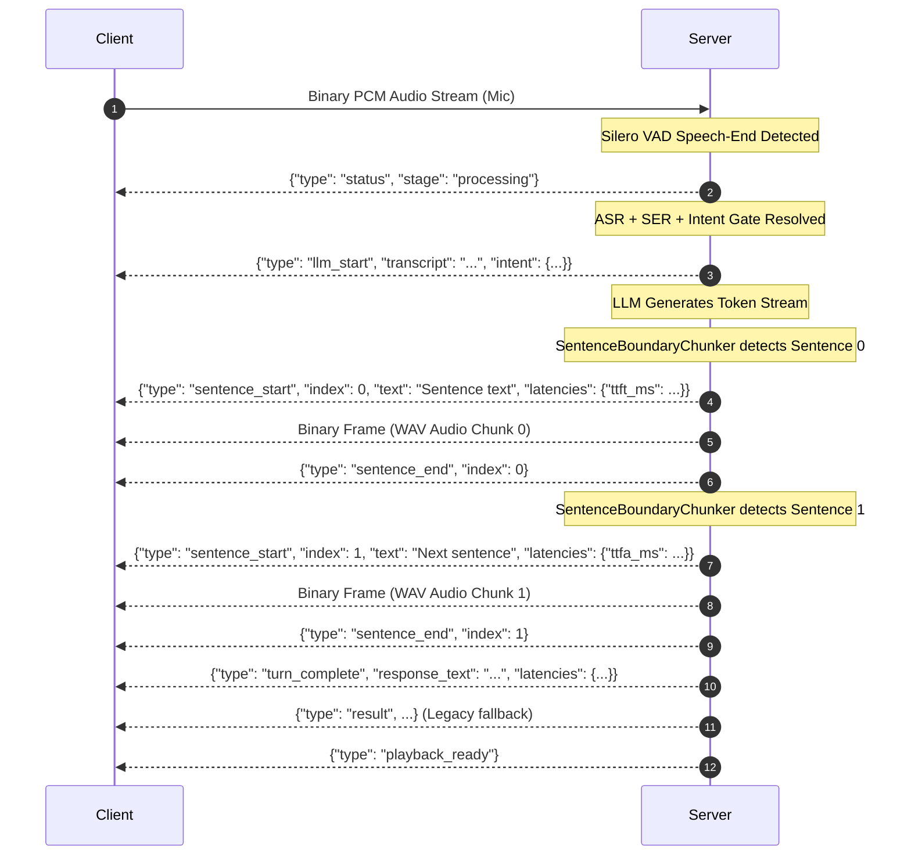

# SenseAI Voice Assistant — WebSocket Streaming API Contract

Version: `0.7.0` (Phase 7: Streaming LLM + Indic Parler-TTS)  
Protocol: `WebSocket` (Endpoint: `ws://127.0.0.1:8000/ws/voice`)  
Subprotocol: Binary + UTF-8 JSON text multiplexing

---

## 1. Overview & Transport Guarantees

The `/ws/voice` endpoint provides real-time, full-duplex voice communication between the React client and the SenseAI backend pipeline. It supports:
- **Continuous Client Ingestion**: Streaming raw 16kHz mono PCM16 audio chunks to an active Silero VAD segmenter.
- **Pipelined Server Egress**: As soon as speech finishes, the backend performs language routing, intent classification, and streams the LLM response token-by-token through a `SentenceBoundaryChunker`. Each completed sentence triggers immediate `Indic Parler-TTS` synthesis, sending audio frames before the entire generation finishes.

---

## 2. Client-to-Server Message Specification

The client communicates over the socket using two message modes:

### A. Binary Frames (Audio Stream)
- **Format**: Raw 16-bit linear PCM, 16000 Hz sample rate, single channel (mono), Little-Endian.
- **Chunk Interval**: Typically 20ms to 100ms frames (~640 to 3200 bytes per frame).
- **Semantics**: Pushed continuously while recording. Silero VAD buffers and segments speech in real-time.

### B. Text JSON Frames (Control Signals)
| Action / Type | Payload Schema | Description |
| :--- | :--- | :--- |
| `ping` | `{"action": "ping", "conversation_id": "conv_xxx"}` | Heartbeat check; responds with `pong`. |
| `reset` | `{"action": "reset"}` | Clears the active VAD audio buffer and resets pipeline state. |
| `end-of-utterance` | `{"action": "end-of-utterance"}` | Explicitly forces the VAD segmenter to flush buffered audio and trigger inference. |

---

## 3. Server-to-Client Message Specification

The server sends interleaved JSON metadata/control events and binary WAV audio frames.

### Event Sequence per Utterance Turn



### Detailed Event Schemas

#### 1. `llm_start`
Dispatched immediately when ASR, language identification, and intent gating have finalized, and before the first token is synthesized.
```json
{
  "type": "llm_start",
  "conversation_id": "conv_a1b2c3d4",
  "transcript": "What is the warranty period for SenseAI?",
  "context": {
    "language": "en",
    "script": "latin",
    "mixed_language": false,
    "confidence": 0.98,
    "model_used": "SenseVoiceSmall"
  },
  "intent": {
    "category": "knowledge",
    "confidence": 0.95,
    "matched_rule": "warranty",
    "cited_docs": ["warranty_terms.txt"],
    "chunks_count": 2
  },
  "emotion": {
    "primary": "neutral",
    "confidence": 0.85,
    "valence": 0.0,
    "arousal": 0.0,
    "lexical_polarity": 0.0
  }
}
```

#### 2. `sentence_start`
Dispatched when `SentenceBoundaryChunker` completes a sentence unit.
```json
{
  "type": "sentence_start",
  "conversation_id": "conv_a1b2c3d4",
  "index": 0,
  "text": "Based on warranty_terms.txt: SenseAI hardware comes with a 1-year limited warranty covering manufacturing defects.",
  "latencies": {
    "chunk_tts_ms": 32.5,
    "ttft_ms": 110.2,
    "ttfa_ms": 195.4
  }
}
```

#### 3. Binary WAV Frame
- **Payload**: Standard RIFF WAV format (16kHz or 24kHz PCM16, mono).
- **Association**: Follows immediately after the corresponding `sentence_start` and precedes `sentence_end`.

#### 4. `sentence_end`
Demarcates the end of audio transmission for chunk `index`.
```json
{
  "type": "sentence_end",
  "conversation_id": "conv_a1b2c3d4",
  "index": 0
}
```

#### 5. `turn_complete`
Emitted once the entire LLM response has streamed and all sentence audio chunks have been transmitted.
```json
{
  "type": "turn_complete",
  "conversation_id": "conv_a1b2c3d4",
  "transcript": "What is the warranty period for SenseAI?",
  "response_text": "Based on warranty_terms.txt: SenseAI hardware comes with a 1-year limited warranty covering manufacturing defects. It does not cover accidental water damage.",
  "latencies": {
    "asr_ms": 42.1,
    "emotion_ms": 0.8,
    "rag_ms": 3.4,
    "ttft_ms": 110.2,
    "ttfa_ms": 195.4,
    "llm_ms": 312.0,
    "total_ms": 445.6
  },
  "context": {...},
  "intent": {...},
  "emotion": {...}
}
```

---

## 4. Message Ordering & Concurrency Guarantees

1. **Strict FIFO Ordering**: WebSocket TCP ordering guarantees that control text events and binary chunks arrive in exact linear order.
2. **Chunk Framing Invariant**: Every binary audio chunk is framed by `sentence_start(i)` and `sentence_end(i)`. No binary audio will be sent outside this frame boundary.
3. **Client Playback Queue**: The client MUST queue incoming binary chunks into a FIFO queue (`AudioQueue`) and play them sequentially without overlapping or truncating previous chunks.
4. **Idempotent Turn Demarcation**: If a client only cares about complete text (e.g. non-streaming UI or test assertions), it can subscribe exclusively to `turn_complete` or `result`.

---

## 5. Latency Telemetry Definitions

- **ASR Latency (`asr_ms`)**: Duration from VAD utterance segmentation to transcript availability.
- **Time-to-First-Token (`ttft_ms`)**: Duration from LLM invocation to emission of the first response token. Target: `< 200ms`.
- **Time-to-First-Audio (`ttfa_ms`)**: Duration from initial utterance speech-end detection to dispatch of the first synthesized audio chunk. Target: `< 500ms`.
- **Roundtrip Total (`total_ms`)**: Elapsed duration for the entire end-to-end processing turn.
