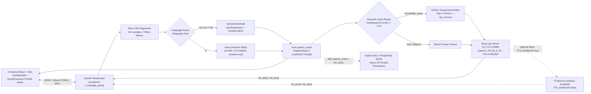

# VoiceSense AI — Final System Architecture

This document describes the **verified implemented architecture** of VoiceSense AI as of Phase 12. The pre-rebuild historical audit remains preserved in [`current-state.md`](./current-state.md), and database internals are detailed in [`database.md`](./database.md).

---

## 1. End-to-End Pipeline

---

## 2. Module Boundaries & Dependency Isolation

The active codebase separates concerns across four top-level packages (`backend/`, `ai/`, `rag/`, `frontend/`), leaving legacy prototypes quarantined under `src/`:

| Package | Responsibility | Forbidden Dependencies | Enforcement |
|---|---|---|---|
| `ai/` | Audio preprocessing (`vad.py`), ASR/emotion wrappers (`sensevoice.py`, `indicconformer.py`), emotion training & evaluation (`ai/training/`) | `backend.*`, `rag.*`, `src.*`, LLM/TTS | `scripts/ci/check_import_isolation.py` |
| `rag/` | Document chunking & indexing (`ingestion.py`), embeddings (`embeddings.py`), semantic intent gate (`intent_router.py`), vector retrieval (`retriever.py`) | `backend.*`, `ai.*`, `src.*` | Package convention (`check_import_isolation.py` targets `ai/` & `speech_service.py`) |
| `backend/app/` | FastAPI lifecycle, REST routers, WebSocket protocol, SQLAlchemy ORM persistence, LLM/RAG/TTS orchestration (`speech_service.py` stays isolated) | `src.*` (`speech_service.py` forbids LLM/RAG/TTS) | `scripts/ci/check_import_isolation.py` |
| `frontend/` | React + TypeScript UI, PCM16 capture hook, in-memory JWT state, WebSocket client, history drawer | Backend internals (communicates over `/api/*` & `/ws/speech`) | TypeScript + Vitest + Vite build |

---

## 3. Lazy Engine Loading & Event-Loop Keepalive

To prevent startup timeouts and minimize idle RAM:
- **Lazy by Default:** `LAZY_LOAD_MODELS=true` and `PRELOAD_DEFAULT_ENGINE=false`. Neither SenseVoiceSmall nor IndicConformer-600m loads until the first turn requesting that engine arrives. When a model is loading, the server emits `{"type": "status", "state": "loading_model", "engine": ...}` and clears it with `"model_ready"`.
- **Lazy ML Package Imports:** Heavy ML frameworks (`torch`, `funasr`, `nemo`, `sentence_transformers`) are imported inside load paths rather than module top-level, letting the CI-lite environment (`requirements-ci.txt`) import and test the full backend without ML packages installed.
- **Worker-Thread Execution + `_message_pump` Keepalive:** ASR/emotion inference runs inside `asyncio.to_thread(...)` guarded by `asyncio.Semaphore(INFERENCE_CONCURRENCY_LIMIT)` (default `2`). An active `_message_pump` coroutine continuously drains uvicorn's ASGI receive queue and answers `{"type": "ping"}` frames immediately so WebSocket keepalive never stalls behind `pause_reading()`.
  - **Measured Cold-Load Stall:** During a `49 s` multi-turn session loading SenseVoiceSmall and IndicConformer on CPU, maximum asyncio event-loop stall was **`225.9 ms`** (`759` ticks), keeping default uvicorn WebSocket pings (`--ws-ping-interval 20 --ws-ping-timeout 20`) intact (`brain/16_CHANGELOG.md`, Phase 10b).

---

## 4. Failure-Isolation Guarantees

The voice pipeline degrades gracefully whenever downstream or storage components fail:

| Degraded Component | Behavior | Client Signal | Verified By |
|---|---|---|---|
| **LLM down / timeout / bad output** | `speech_result` still arrives first; LLM failure triggers circuit breaker (`3` failures -> `15.0 s` cooldown) without dropping the socket | `error` with `llm_unavailable` or `llm_bad_response` | `tests/backend/test_degraded_pipeline.py`, `test_llm_service.py` |
| **RAG index missing / `faiss` blocked** | Index falls back to `NumpyVectorIndex` if `faiss` fails to load; missing/empty index falls back to direct chat | `status` with `status: "rag_fallback"` | `tests/backend/test_rag_service.py`, `tests/rag/` |
| **TTS disabled or OOM / crash** | Default `TTS_ENABLED=false`; if enabled and failing, enters `60.0 s` cooldown and continues text-only | `/api/health` shows `tts: "disabled"` or `error` `tts_unavailable` | `tests/backend/test_tts_service.py`, `test_degraded_pipeline.py` |
| **Database unreachable / write error** | Persistence (`HistoryService.record_voice_turn`) runs asynchronously after `speech_result` and `llm_done`; errors are logged and swallowed | Voice turn completes uninterrupted | `tests/backend/test_db_fault_isolation.py` |
| **Auth disabled (`AUTH_REQUIRED=false`)** | Connections without `auth_token` still run speech/LLM normally with zero DB persistence | Normal `ready` & `speech_result` | `tests/backend/test_websocket.py`, [`websocket.md`](../api/websocket.md) |

---

## 5. Measured Memory & Compute Footprints

All numbers below come directly from recorded logs under `docs/deployment/runs/` and `docs/architecture/language-routing.md`:

| Workload / Component | Measured Footprint | Source File |
|---|---|---|
| Base Python + PyTorch runtime (no ASR weights) | `511.3 MB` WS / `1,228.9 MB` Private | `docs/deployment/runs/lid_eval_existing_samples.txt` |
| IndicConformer-600m process RSS on CPU (`ctc` / `rnnt`) | `3,749–3,750 MB` (`ctc`), `3,738–3,740 MB` (`rnnt`) | `docs/architecture/language-routing.md` |
| Qwen3-1.7B `Q4_K_M` via `llama.cpp` on RTX 2050 | `1,520 MiB` VRAM (`tts-benchmark-rtx2050.md`) / `1,479 MiB` (`brain/16_CHANGELOG.md`) | `docs/deployment/tts-benchmark-rtx2050.md` |
| Indic Parler-TTS (`float16`, GPU clamped standalone) | `2,185–2,709 MiB` VRAM peak (`RTF 2.65–5.12`) | `docs/deployment/runs/tts_llama_stopped.txt` |
| SenseVoice + IndicConformer + RAG on Windows 16 GB RAM | `30,280 MB` (`94.1%` of `32,176 MB` commit limit) to `30,391 MB` (`80.3%` of `37,865 MB`) — spawning TTS hits `os error 1455` / `0xC0000005` | `docs/deployment/tts-benchmark-rtx2050.md` |

> [!NOTE]
> Dual-engine container estimates (~`11.8 GB` private RAM) cited in `docs/deployment/docker.md` come from Phase 11 planning notes and remain **unverified** under live Docker runtime because Docker containers have not yet been executed.
