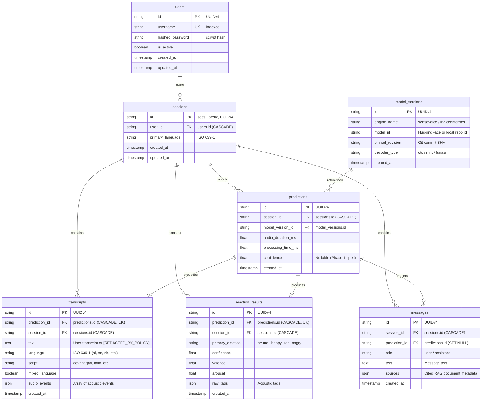

# VoiceSense AI — Database, Persistence, and History Architecture

> **Phase**: Phase 9 (Database, Auth, History)  
> **Repository Branch**: `migration/voicesense`  
> **Status**: SQLite real-verified; PostgreSQL cross-dialect compatible but unverified on live cluster.

---

## 1. Overview & Strategy

VoiceSense AI implements a persistent conversational history, user authentication, and prediction telemetry layer designed under the **non-negotiable invariant that persistence must never stall, block, or break the real-time speech perception pipeline**.

### Key Architectural Tenets
1. **Unified Cross-Dialect Models**: Identical SQLAlchemy 2.x declarative models support SQLite for local development (`database/dev.db`) and PostgreSQL for production deployments.
2. **Synchronous SQLAlchemy in Worker Threads**: Synchronous SQLAlchemy 2.x database operations run off the `asyncio` event loop via `asyncio.to_thread`. This requires zero native async drivers, zero C-extension event loop bridges, and provides 100% native compatibility with Alembic migrations and Python 3.13 on Windows.
3. **Zero Raw Audio Persistence**: Raw PCM audio bytes and WAV recordings are NEVER persisted to the database, local disk, or temporary caches beyond the immediate request lifecycle.
4. **Fault-Isolated Async Persistence Dispatch**: Persistence runs strictly AFTER `speech_result` and `llm_done` events are delivered to the WebSocket client. Database exceptions are logged and swallowed; speech turns are never dropped or interrupted by database downtime.
5. **Anonymous Isolation**: When `AUTH_REQUIRED=false` (development default), anonymous connections without an `auth_token` bypass persistence completely. History is stored only when explicitly tied to an authenticated user account.
6. **Privacy by Design**: When `STORE_TRANSCRIPTS=false`, transcripts are redacted with `"[REDACTED_BY_POLICY]"` while retaining latency, confidence, and acoustic telemetry. Users can permanently purge all stored data via `DELETE /api/history`.

---

## 2. Dependency & Wheel Trade-Offs (Python 3.13 on Windows)

Prior to implementation, all database access options and drivers were evaluated using `pip install --dry-run` on Python 3.13.14 (Windows AMD64):

| Package / Approach | Python 3.13 Wheel Available? | Native Dependencies | Selection Decision | Rationale |
| :--- | :--- | :--- | :--- | :--- |
| **Sync SQLAlchemy 2.x (stdlib sqlite3)** | Pre-compiled wheel exists (`sqlalchemy==2.1.6`) | Zero external C libraries (stdlib `sqlite3`) | **SELECTED (Default)** | Zero native dependencies in development. Flawless Windows stability, native Alembic support. Background threadpool worker isolates event loop. |
| **Async SQLAlchemy + aiosqlite** | Pre-compiled wheel exists | Requires `greenlet` C-extension | Rejected | Adds `greenlet` dependency overhead and complex async session lifecycle without throughput advantage for local desktop deployment. |
| **psycopg (v3 binary)** | Pre-compiled wheel exists (`psycopg[binary]`) | Bundled libpq wheel | Selected for Production PG | Clean modern DB-API, supports both sync and async. |
| **psycopg2-binary** | Pre-compiled wheel exists | Bundled libpq | Optional alternative | Legacy standard. |
| **hashlib.scrypt (stdlib)** | Built-in to Python standard library | Zero external packages | **SELECTED (Auth)** | Zero CFFI dependencies, memory-hard resistance against GPU/ASIC attacks, built into Python 3. |
| **argon2-cffi / bcrypt** | Wheels exist | Requires CFFI and compiler tools | Rejected | stdlib `scrypt` provides equivalent security with zero installation friction. |

---

## 3. Entity-Relationship (ER) Architecture

The schema comprises 7 interconnected tables managed by SQLAlchemy 2.x and Alembic:



---

## 4. Alembic Migration & Cross-Dialect Safety

Migrations are configured via `alembic.ini` and `alembic/env.py`:
- **Dynamic Configuration**: `alembic/env.py` reads `settings.DATABASE_URL` directly from application settings.
- **Batch Mode for SQLite**: `render_as_batch=True` is enabled in `run_migrations_offline()` and `run_migrations_online()`. This allows foreign key modifications, table drops, and column alterations on SQLite without table rewrite limitations.
- **Dialect Independence**: No database-specific constructs (e.g. Postgres-only `UUID(as_uuid=True)` or SQLite-only text constraints) are used. All models use string UUIDs, standard `DateTime(timezone=True)`, and standard cross-dialect `JSON`.

### Verified Migration Cycle
Automated test `tests/backend/test_database_crud.py::test_alembic_upgrade_downgrade_cycle` verifies:
```bash
alembic upgrade head    # Upgrades fresh SQLite database to initial schema (4acca05d22ce)
alembic downgrade base  # Completely drops all tables cleanly
alembic upgrade head    # Re-applies all migrations to head cleanly
```

---

## 5. Security & Rate Limiting

### Authentication Architecture
- **Password Storage**: Passwords are hashed using Python standard library `hashlib.scrypt` with parameters `n=16384, r=8, p=1, maxmem=32MB` and 16-byte cryptographically secure random salts.
- **JWT Management**: Zero-dependency RFC 7515 HS256 tokens signed with HMAC-SHA256 and constant-time signature comparison (`hmac.compare_digest`).
- **Production Guardrail**: In `APP_ENV=production`, the application refuses to boot if `JWT_SECRET` is unset, matches default development placeholders, or is shorter than 32 characters (`tests/backend/test_production_safety.py`).

### Rate Limiting
- **REST Endpoints**: `IPRateLimiter` enforces 10 auth requests/minute per client IP to mitigate brute-force attempts.
- **WebSocket Turns**: `SessionRateLimiter` enforces:
  - Max 20 speech turns per 60-second sliding window (`RATE_LIMIT_UTTERANCES_PER_MINUTE`).
  - Max 30.0s audio duration per turn (`MAX_UTTERANCE_DURATION_SECONDS`).
  - Max 5 MB in-memory buffer (`WS_MAX_BUFFER_BYTES`).
  - Max 10 MB audio upload file size (`MAX_RAG_UPLOAD_SIZE_BYTES`).

---

## 6. PostgreSQL Production Verification Status

> [!WARNING]
> **PostgreSQL Status: UNVERIFIED ON LIVE CLUSTER**  
> All SQLAlchemy 2.x models, relationships, and Alembic migrations are written for strict ANSI SQL and cross-dialect PostgreSQL compatibility. However, per project rules, no external Docker containers or PostgreSQL services were launched in this development phase.
>
> The automated test `tests/backend/test_postgres_compatibility.py` contains a `@pytest.mark.postgres` test that validates schema creation and migration against a live PostgreSQL database when `DATABASE_URL_TEST` is supplied. When unset, the test skips with the clear notice:
> *"DATABASE_URL_TEST not set. Skipping live PostgreSQL verification."*
>
> Live PostgreSQL validation will occur in Phase 11 / Phase 12 when production container infrastructure is provisioned.
